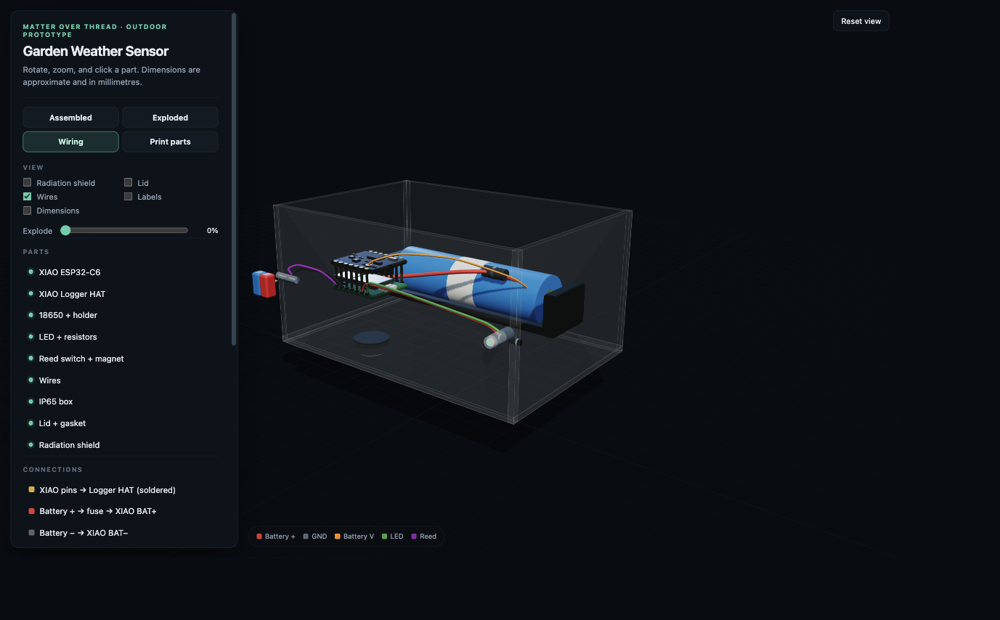

# 3D prototype

An interactive 3D model of the sensor is in [`viewer/`](../viewer/README.md).

It runs in the browser with Three.js and shows:

- the XIAO ESP32-C6
- the SHT40 sensor
- the 18650 battery and holder
- the IP65 box, lid, gasket, and Gore vent
- the 3D-printed radiation shield
- the LED, reed switch, magnet, and wires
- the assembly order
- the electrical connections



## How to open it

```bash
cd viewer
npm install
npm run dev
```

Then open <http://127.0.0.1:5173/>.

## What each view is for

| View | Use it to understand |
|---|---|
| **Assembled** | What the finished device looks like |
| **Exploded** | The order of the box, lid, and electronics |
| **Wiring** | Which wire goes where |
| **Print parts** | The shape of the 3D-printed radiation shield |

## Suggested tour

1. Start in **Wiring** to see the electronics inside the box.
2. Click **XIAO ESP32-C6** in the Parts list. The camera zooms in and a card
   explains the part.
3. Click each connection in the Connections list. The matching wires stay
   visible; the others disappear.
4. Click **Exploded** to see the lid and electronics lift out of the box.
5. Click **Assembled** to see the shield around the box.
6. Click **Print parts** to see the shield plates fanned out. This is the part
   your friend prints.

## Important

The viewer models the outdoor concept with a separate SHT40 breakout at the
bottom of the box. It does not show the Logger HAT that the bench kit uses.
The sensor placement in the final build depends on the bench-test offset; see
[Enclosure](09-enclosure.md#vent-and-sensor-placement).

This is a **concept model**, not a manufacturing CAD file. The dimensions are
approximate. The final STL/STEP files for the enclosure will be created after
the exact IP65 box is measured.

The model is intentionally simple:

- It uses boxes and cylinders for the boards and connectors.
- The box and lid are semi-transparent in the viewer so you can see inside.
- The real box is opaque white.
- The wire routing is illustrative, not a final harness drawing.

## Why a 3D viewer?

The project has several parts that are hard to picture from a text list:

- the sensor sits at the bottom, over the vent
- the battery is large and needs its own space
- the XIAO's antenna must stay away from metal
- the lid gasket is a separate seal
- the shield is a stack of plates, not a solid box
- the wires cross from one side of the box to the other

The viewer makes those relationships visible before you cut or drill
anything.
