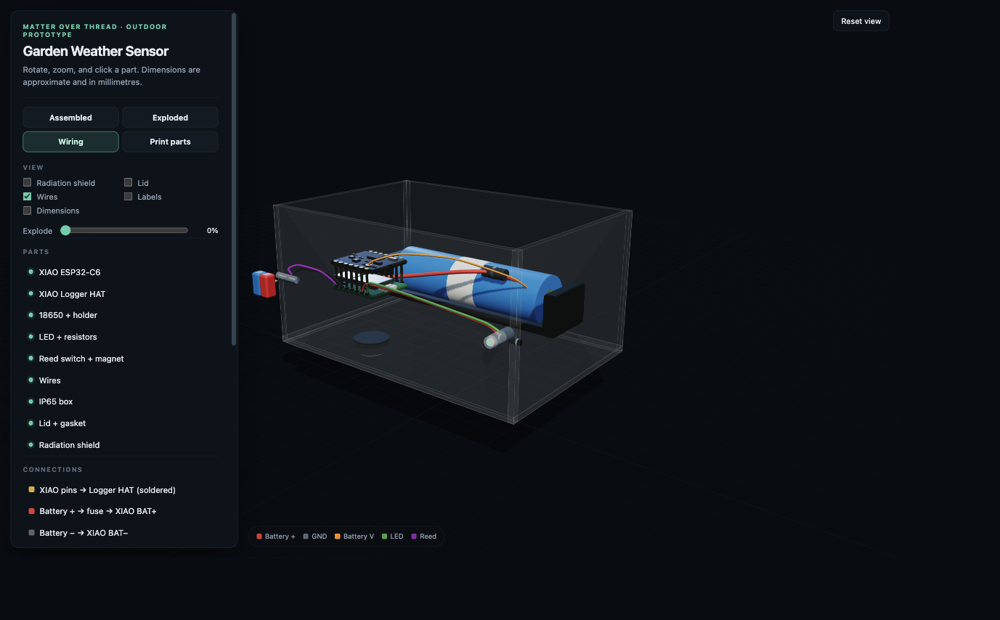
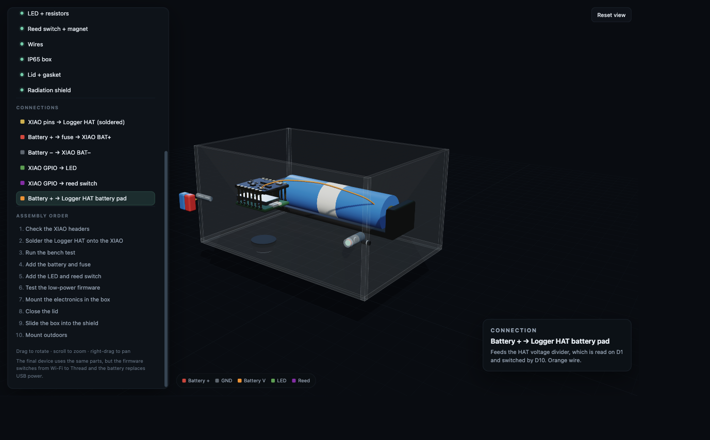
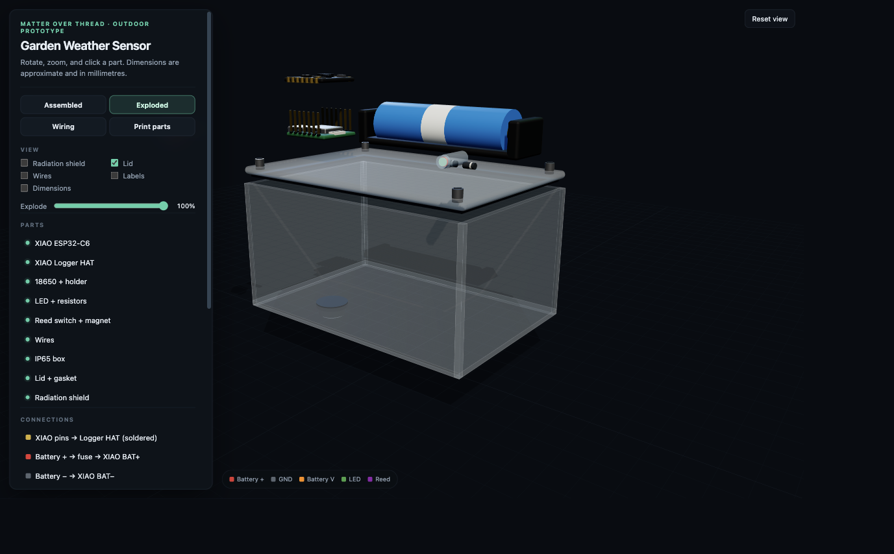
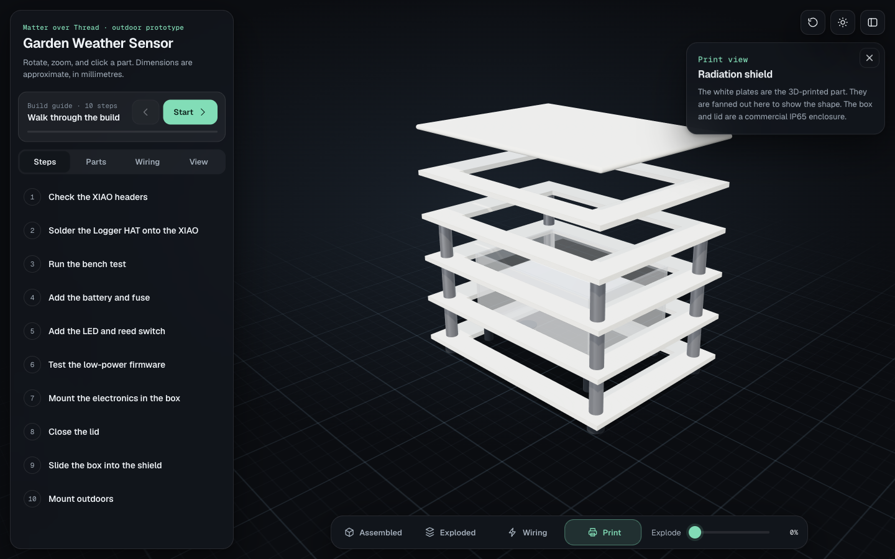

# 3D prototype viewer

An interactive Three.js model of the garden weather sensor. It is here to
help you understand the parts, how they fit together, the wiring, and the
assembly order.

This is a **concept model**, not a manufacturing CAD file. Dimensions are
approximate. The real STL/STEP files for the printed shield will be added
later, after the box is measured.



## Live demo

<https://favasconcelos.github.io/weather-iot-device/>

Deployed automatically from `main` by
`.github/workflows/deploy-viewer.yml` whenever something under `viewer/` changes.

## Run it

```bash
cd viewer
npm install
npm run dev
```

Open <http://127.0.0.1:5173/>.

Production build:

```bash
npm run build
npm run preview
```

The build output is `viewer/dist/`. Three.js is bundled; no CDN is needed at
runtime.

## Controls

- **Drag** to rotate.
- **Scroll** to zoom.
- **Right-drag** to pan.
- **Click a part** in the 3D view or in the Parts list to select it.
- **Click a connection** to highlight those wires.
- **Click an assembly step** to move to the relevant view.

## The four views

| View | What it shows |
|---|---|
| **Assembled** | The finished device: box, lid, and radiation shield |
| **Exploded** | The lid and electronics lifted out, so you can see the internal order |
| **Wiring** | The box in x-ray mode, with the colour-coded wires |
| **Print parts** | The printed radiation shield, fanned out to show its shape |

The **Explode** slider moves between assembled and exploded. The checkboxes
turn the shield, lid, wires, labels, and dimensions on or off.

## Screenshots

### Wiring


### Connection highlight



### Exploded



### Printed shield



## What is modelled

- Seeed XIAO ESP32-C6, with USB-C, shield can, antenna area, and tall header
  pins
- Seeed XIAO Logger HAT soldered on top of the XIAO: SHT40, BH1750 light
  sensor, PCF8563 clock with its crystal, the divider transistor, and the
  battery pad. It needs no wires
- Protected 18650 cell in a holder
- IP65 box, lid, gasket, screws, and Gore vent
- Six-plate radiation shield with spacers and feet
- Bi-colour LED, resistors, reed switch, and magnet
- Colour-coded wires:
  - red: battery positive
  - black: battery negative
  - green: LED
  - purple: reed switch
  - orange: battery voltage to the Logger HAT battery pad

## What is simplified

- The PCB traces, exact connector shapes, and component footprints are
  simplified.
- The XIAO and the Logger HAT are represented by their board outlines and main
  components; the model is not a mechanical drawing. The HAT pad positions
  and the battery wiring on the real board are not checked yet.
- The Gore vent is under the XIAO and HAT stack. If the bench test shows the
  HAT reads too warm, the sensor will move to a separate breakout and the
  model will change.
- The box is a generic 100 × 68 × 50 mm IP65 enclosure.
- The shield is an early concept: six 150 × 110 mm plates with a central
  110 × 78 mm opening. The final dimensions depend on the box you buy.
- The lid and box are shown semi-transparent so you can see inside. The real
  parts are opaque white.

## Source layout

```
viewer/
├── index.html
├── package.json
├── tsconfig.json
├── vite.config.ts
├── screenshot-*.png
└── src/
    ├── main.ts        scene, UI, interactions
    ├── parts.ts       geometry and part descriptions
    ├── dimensions.ts  dimension lines
    ├── geometry.ts    reusable geometry helpers
    ├── materials.ts   colours and materials
    ├── styles.css     UI styling
    └── types.ts       shared types
```
